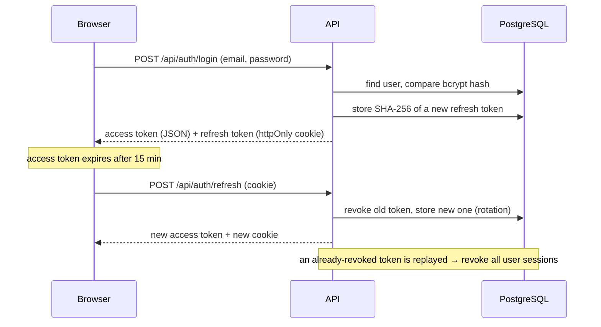

# DevFlow

[](https://github.com/andreluizruffo/devflow/actions/workflows/ci.yml)

DevFlow is a SaaS for freelancers and small teams to manage clients, projects and tasks on a Kanban board, with an AI assistant that suggests tasks from a project description.

> **Status: in progress.** Authentication and the multi-tenant data model are done and tested. Organizations, clients, projects, the Kanban board, the AI assistant and the public demo are next (see [Roadmap](#roadmap)).

## Tech stack

| Layer    | Tools                                                                                                 |
| -------- | ----------------------------------------------------------------------------------------------------- |
| Frontend | React 19, TypeScript, Vite, React Router, TanStack Query, React Hook Form + Zod, Tailwind CSS         |
| Backend  | Node.js, TypeScript, Express 5, Prisma 7, PostgreSQL 17, Zod, JWT                                     |
| Tests    | Jest + Supertest (API, against a real PostgreSQL test database), Vitest + React Testing Library (UI)  |
| Tooling  | npm workspaces monorepo, ESLint, Prettier, Docker Compose, GitHub Actions (PostgreSQL in a container) |

## What is built so far

- **Authentication**
  - Sign-up creates the user, their organization and an `OWNER` membership in a single transaction.
  - Passwords hashed with bcrypt. Login returns the same error for an unknown email and a wrong password, and takes about the same time in both cases, so it never reveals which emails have an account.
  - Short-lived JWT access token (15 min) kept **in memory only** on the frontend.
  - Refresh token in an `httpOnly`, `SameSite=Strict` cookie, stored in the database **only as a SHA-256 hash**.
  - **Refresh token rotation with reuse detection:** every refresh revokes the token used; if an old token is replayed, every session of that user is revoked.
  - Session restored on page reload; protected and guest-only routes.
- **Multi-tenant data model**
  - Every business table carries `organizationId`.
  - A **composite foreign key** makes the database itself reject a task that points to a project of another organization — even if the application code has a bug.
- **API conventions:** Zod validation at the boundary, consistent JSON errors (`{ error: { code, message } }`), no stack traces in production responses, environment variables validated at startup.

## Architecture

```
frontend (Vite, :5173) ──/api──▶ backend (Express, :3333) ──▶ PostgreSQL
```

Backend flow: **Route → Controller → Service → Repository → Prisma**. Controllers only deal with HTTP; business rules live in services; database access is isolated in repositories. The backend never trusts `organizationId`, `userId` or roles sent by the client: they always come from the verified token and the database.

### Authentication flow



## Getting started

**Requirements:** Node.js 22+ and PostgreSQL 17 (installed locally, or run `docker compose up db`).

```bash
git clone https://github.com/andreluizruffo/devflow.git
cd devflow
npm install                 # also generates the Prisma client
cp .env.example .env        # then fill in the database password and a long JWT secret
```

Create two databases, `devflow` and `devflow_test`, then:

```bash
npm run db:migrate          # apply migrations
npm run db:seed             # demo data
npm run dev:backend         # API on http://localhost:3333
npm run dev:frontend        # app on http://localhost:5173
```

Demo login after seeding: `demo@devflow.dev` / `devflow123`.

## Scripts

| Command                | What it does                                       |
| ---------------------- | -------------------------------------------------- |
| `npm test`             | API tests (Jest + Supertest) and UI tests (Vitest) |
| `npm run lint`         | ESLint on the whole monorepo                       |
| `npm run typecheck`    | TypeScript in strict mode, backend and frontend    |
| `npm run format:check` | Prettier                                           |
| `npm run build`        | Production build of both apps                      |
| `npm run db:studio`    | Browse the database with Prisma Studio             |

## Roadmap

- [x] Project setup: monorepo, strict TypeScript, lint, tests, CI
- [x] Database: Prisma schema, migrations, seed, tenant constraints
- [x] Authentication: register, login, refresh rotation, logout, protected routes
- [ ] Organizations: members, roles, cross-organization isolation tests
- [ ] Clients
- [ ] Projects: budget, deadlines, status
- [ ] Tasks: priority, assignee, due date
- [ ] Kanban board with drag and drop
- [ ] AI assistant that suggests tasks from a project description (output validated with Zod)
- [ ] Docker Compose for all services and public demo deploy
